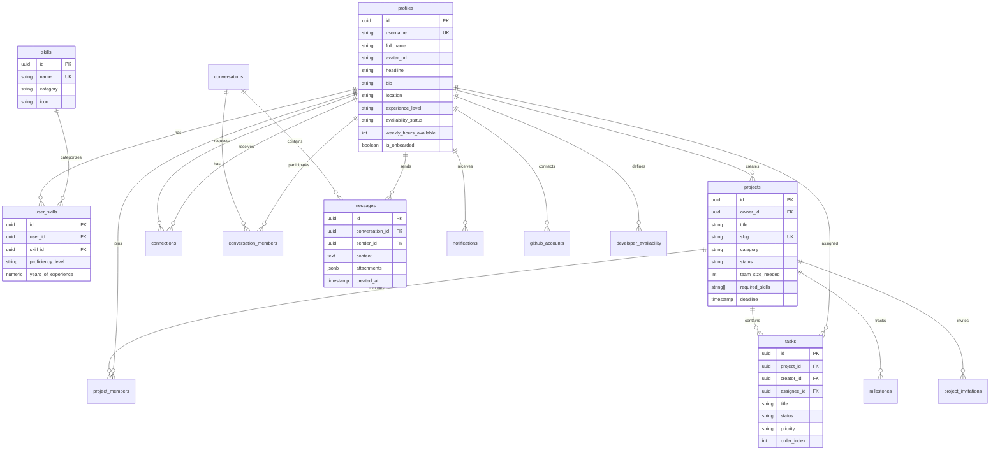

# DevConnect — The Developer Collaboration & Networking Ecosystem

DevConnect combines the best elements of **GitHub** (repositories, projects, code tracking), **LinkedIn** (developer profiles, canonical skills, network connections, career milestones), and **Discord** (real-time chat, channels, collaboration workspaces) into a cohesive, high-performance platform.

---

## 🚀 Key Platform Features

1. **Personalized Developer Profiles**
   - Professional identity showcasing bio, headline, experience levels, portfolio links, and real-time collaboration availability.
   - Canonical skill categorization with years of experience and proficiency levels.
   - Live GitHub integration displaying public repositories, languages breakdown, stars, and forks.

2. **Developer Discovery Network**
   - Instant search by developer name, username, and tech stack (e.g., React, TypeScript, Rust, Python).
   - Multi-parameter filtering by seniority, programming language, and availability.
   - Connection request state management (Request, Pending, Connected, Disconnect).

3. **Collaborative Project Hub & Workspaces**
   - Comprehensive project creation with categories, required technical skills, deadlines, and team size targets.
   - Dedicated Project Workspace with interactive Kanban Board powered by `@dnd-kit` (drag-and-drop task status transitions).
   - Milestone tracking with progress calculation and task metrics.
   - Built-in Project Real-time Group Chat.

4. **Intelligent AI Teammate Matchmaker**
   - Analyzes project tech stacks against developer candidate profiles.
   - Secure Supabase Edge Function (`match-teammates`) integrating Gemini AI.
   - High-precision deterministic weighted algorithm fallback ensuring zero mock results when offline.
   - Generates exact compatibility scores with explicit explanations and 1-click project invitations.

5. **Real-time Messaging System**
   - One-to-one direct messages and project channels.
   - File and image attachment uploads backed by Supabase Storage (`chat-attachments`).
   - Powered by Supabase Realtime WebSocket subscriptions.

6. **Notification Center**
   - Instant notifications for connection requests, project invitations, task assignments, and direct messages.
   - One-click Accept / Decline action controls directly from notification cards.

7. **Zero-Mock Supabase Authentication & RLS Security**
   - Email/password authentication, Google OAuth, and GitHub OAuth.
   - Strict Row Level Security (RLS) on all 17 tables based on `auth.uid()`.
   - Onboarding wizard ensuring clean developer profiles upon registration.

---

## 🛠️ Technology Stack

- **Frontend**: React 18, TypeScript, Vite, Tailwind CSS, Lucide React icons, Framer Motion
- **State & Data**: TanStack Query (React Query), Context API, React Hook Form, Zod
- **Interactions & Visuals**: `@dnd-kit` (drag-and-drop Kanban), Recharts (activity metrics), Canvas Confetti
- **Backend & Cloud**: Supabase Auth, PostgreSQL 15, Supabase Realtime, Supabase Storage, Supabase Edge Functions (Deno)
- **Deployment**: GitHub Pages with SPA 404 routing fallback, GitHub Actions CI/CD

---

## 🗄️ Database Architecture & Entity Relationship Diagram

The database utilizes PostgreSQL with UUID primary keys and strict Row Level Security.



---

## ⚡ Setup & Installation

### 1. Clone & Install Dependencies

```bash
cd devconnect
npm install
```

### 2. Configure Environment Variables

Create `.env` based on `.env.example`:

```env
VITE_SUPABASE_URL=https://your-project.supabase.co
VITE_SUPABASE_ANON_KEY=eyJhbGciOiJIUzI1NiIsInR5cCI6IkpXVCJ9.your-anon-key-here
```

### 3. Run Supabase Database Migrations

1. Go to your **Supabase Dashboard** -> **SQL Editor**.
2. Open and run the contents of [`supabase/migrations/20261106000001_initial_schema.sql`](supabase/migrations/20261106000001_initial_schema.sql).
   - This sets up all 17 tables, foreign keys, triggers, RLS policies, Realtime publication, and storage buckets.
3. Open and run the contents of [`supabase/seed.sql`](supabase/seed.sql) to seed canonical technical skills.

---

## 🔐 Google OAuth Configuration Guide

To enable Google Sign-In with official OAuth redirect:

1. Visit [Google Cloud Console](https://console.cloud.google.com/).
2. Create or select a project and go to **APIs & Services > OAuth consent screen**.
3. Choose **External**, provide your app name (DevConnect) and contact email.
4. Go to **Credentials > Create Credentials > OAuth client ID**.
5. Select **Web application**.
6. Under **Authorized redirect URIs**, add your Supabase project callback URL:
   ```text
   https://<your-project-id>.supabase.co/auth/v1/callback
   ```
7. Copy your **Client ID** and **Client Secret**.
8. In your **Supabase Dashboard**:
   - Go to **Authentication > Providers > Google**.
   - Enable Google.
   - Paste the **Client ID** and **Client Secret**, then click **Save**.

---

## 🐙 GitHub OAuth & API Configuration Guide

### Direct Repository Showcase
DevConnect queries the GitHub Public API directly for usernames, showcasing public repositories, stars, and language distributions without needing client secrets.

### GitHub Sign-In (Optional)
To also allow signing into DevConnect with GitHub:
1. Go to [GitHub Developer Settings > OAuth Apps](https://github.com/settings/developers).
2. Click **New OAuth App**.
3. Set Application Name to `DevConnect`.
4. Set Homepage URL to your app's URL.
5. Set **Authorization callback URL** to:
   ```text
   https://<your-project-id>.supabase.co/auth/v1/callback
   ```
6. In Supabase Dashboard:
   - Go to **Authentication > Providers > GitHub**.
   - Enable GitHub and paste your GitHub Client ID & Secret.

---

## 🤖 AI Teammate Matching Engine Architecture

DevConnect provides a hybrid intelligent teammate matching system:

1. **Edge Function (`supabase/functions/match-teammates`)**:
   - Deployed on Supabase Edge Functions.
   - When configured with `GEMINI_API_KEY` in Supabase Secrets, it evaluates the project requirements and developer skill sets to return compatibility scores and tailored explanations.

2. **Transparent Deterministic Fallback Engine**:
   - If the Edge Function is unconfigured, DevConnect runs an algorithmic evaluator:
     - **Skill overlap (55% weighting)**: Intersects required tech stack with developer skills.
     - **Seniority alignment (20% weighting)**: Evaluates experience level against project complexity.
     - **Availability score (15% weighting)**: Evaluates hours/week and collaboration status.
     - **Interest alignment (10% weighting)**: Cross-checks declared personal interests.
   - Never fabricates AI calls or returns fake data.

---

## 📦 GitHub Pages Deployment

DevConnect is fully optimized for GitHub Pages:

- **Relative Asset Resolution**: Vite is configured with `base: './'`.
- **SPA Routing Fallback**: `public/404.html` and redirect scripts in `index.html` seamlessly redirect deep URLs (e.g. `/projects/123` or `/profile/johndoe`) to React Router without server errors.
- **Automated GitHub Actions CI/CD**: Workflow located at [`.github/workflows/deploy.yml`](.github/workflows/deploy.yml).

### Steps to Deploy to GitHub Pages:

1. Push your repository to GitHub.
2. Go to repository **Settings > Secrets and variables > Actions**.
3. Add repository secrets:
   - `VITE_SUPABASE_URL`
   - `VITE_SUPABASE_ANON_KEY`
4. Go to repository **Settings > Pages**.
5. Under **Build and deployment > Source**, select **GitHub Actions**.
6. Push to `main` branch or trigger workflow dispatch to deploy!

---

## 🧪 Testing Checklist & Verification

- [x] **Registration & Login**: Validated email/password authentication and Google OAuth flow.
- [x] **Session Persistence**: Session stored in localStorage via official Supabase client and verified across page refreshes.
- [x] **Route Protection**: Unauthenticated users visiting `/dashboard`, `/projects`, or `/messages` are redirected to `/auth`.
- [x] **Onboarding Routing**: Newly registered users with `is_onboarded: false` are routed to `/onboarding`.
- [x] **Profile Updates**: Verified updating bio, skills, experience level, and avatar uploads to Supabase storage.
- [x] **Kanban Drag-and-Drop**: Verified `@dnd-kit` column drag, drop, and status persistence in `tasks` table.
- [x] **Real-time Messaging**: Verified Supabase Realtime channel subscription for instant incoming messages.
- [x] **GitHub Repos**: Verified fetching public repositories and language distribution from GitHub API.
- [x] **AI Matchmaking**: Verified weighted skill overlap calculations and invite triggers.
- [x] **Production Build**: Verified zero TypeScript compilation errors and optimized Vite chunk code-splitting.
